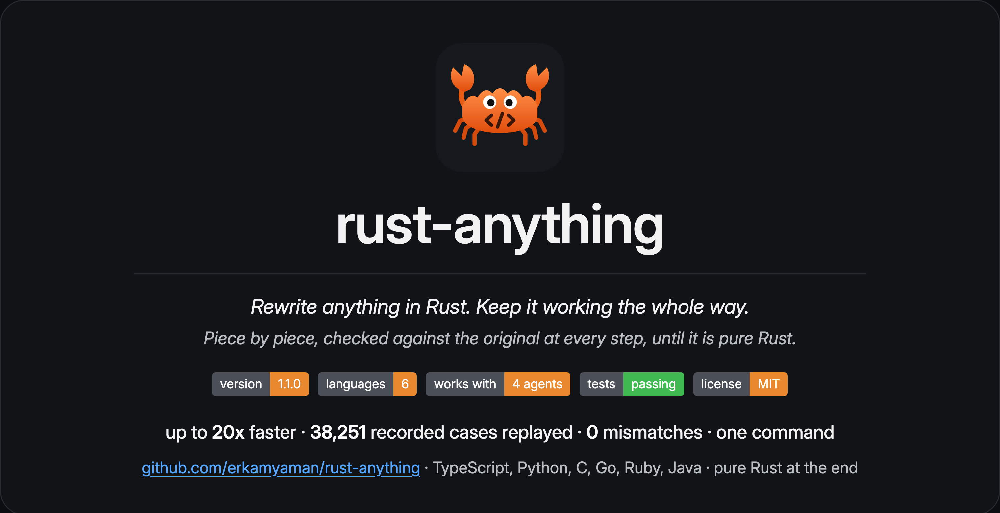
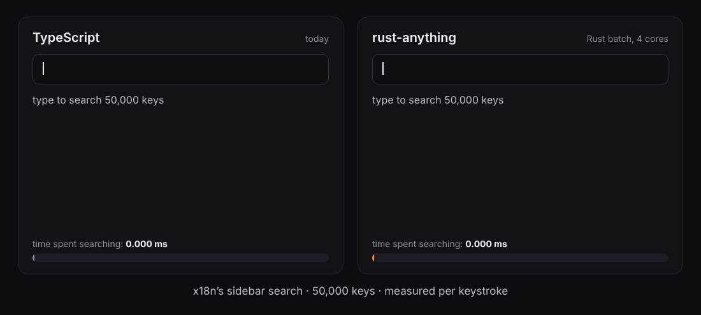

<p align="center">
  
</p>

**Make the slow part of your app fast in Rust, without rewriting the app.** For TypeScript/JavaScript,
Python, C, Go, Ruby and Java codebases, one hot path at a time, proven identical by recorded
behavior.

| Real workload, same results as the original | Original | With rust-anything |
| --- | ---: | ---: |
| x18n's sidebar search, 50,000 keys (TypeScript, Node) | 10 ms per query | **0.5 ms: 20x faster** |
| The same search in the browser (wasm, one thread) | 10 ms | **0.95 ms: 11.5x** |
| `slugify` over 20,000 strings (Python) | 98 ms | **17x faster** |
| `Shellwords.shellescape` from Ruby's standard library, 50,000 values | 88 ms | **11.8x faster** |
| `Slugify` over 50,000 strings (Go) | 49 ms | **4x faster** |
| `slugify` over 50,000 strings (Java) | 43 ms | **3x faster** |

<p align="center">
  
</p>

Measured on 4 cores; every number has a benchmark in [`demo/`](./demo) that first checks the
results are identical. Calling Rust once per small function is usually *slower* than a JIT;
rust-anything finds the loop worth moving, and moves it.

> rust-anything is an independent project, not affiliated with or endorsed by the Rust Project
> or the Rust Foundation. "Rust" is a trademark of the Rust Foundation.

## Quick start

Paste this into Claude Code, Codex, Cursor or Gemini CLI and let your agent install it:

```text
Install rust-anything: run `cargo install --git https://github.com/erkamyaman/rust-anything`,
then `rust-anything setup`. Tell me when to restart you.
```

Or yourself:

```sh
npm install -g rust-anything  # prebuilt binary for macOS, Linux and Windows
# or: cargo install --git https://github.com/erkamyaman/rust-anything
rust-anything setup           # registers it with Claude Code, Codex, Cursor and Gemini CLI
```

Prebuilt binaries are also attached to each [GitHub release](https://github.com/erkamyaman/rust-anything/releases).

In Claude Code you can also install it as a plugin (the MCP server and the skill; the CLI above
must be on your `PATH`):

```text
/plugin install rust-anything --marketplace erkamyaman/rust-anything
```

`setup` adds the MCP server to each agent it finds and installs the workflow skill where the agent
reads skills. It keeps your other settings, is safe to run again, and `--remove` undoes it.
Then ask your agent, for example:

- *"This search feels slow. Profile it with rust-anything and move the hot loop to Rust."*
- *"Plan a migration of `src/parser/` to Rust with rust-anything; port the first unit and prove it."*
- *"Bench the Rust port in `rust/text-rs` against the original and tell me whether to ship it."*

### Works with

| Agent | `rust-anything setup` adds |
| --- | --- |
| Claude Code | MCP server in `~/.claude.json`, skill in `~/.claude/skills/` |
| Codex | MCP server in `~/.codex/config.toml`, skill in `~/.codex/skills/` |
| Cursor | MCP server in `~/.cursor/mcp.json` |
| Gemini CLI | MCP server in `~/.gemini/settings.json` |
| Any other MCP client | add `rust-anything mcp` as a stdio server by hand (see [Install](#install)) |

Before changing a file that exists, `setup` saves a copy beside it (`<file>.rust-anything.bak`).

Or run the steps yourself:

<p align="center">
  
</p>


```sh
rust-anything profile . -- node bench.mjs              # what is hot, and who calls it
rust-anything bridge . src/fuzzy.ts --batch fuzzyScore:text
# write src/port.rs (or let your agent), then:
rust-anything record rust/fuzzy-rs && rust-anything build rust/fuzzy-rs
rust-anything diff rust/fuzzy-rs                       # every recorded case must match
rust-anything bench rust/fuzzy-rs                      # faster? the verdict says
rust-anything gate rust/fuzzy-rs                       # done means this passes
```

rust-anything does not translate code: your coding agent (Claude Code, Codex, Cursor, ...) or you write
the Rust. rust-anything supplies what an agent cannot guess reliably: where the time goes, what to port
first and in which order, a bridge so the rest of the code calls the Rust with its API unchanged,
the exact behavior the port must match, a safe way to ship it, and a gate that says when a port is
done.

## Languages

| Language | Unit | Bridge | Recorded and replayed by |
| --- | --- | --- | --- |
| TypeScript/JavaScript | folder or file | napi-rs or wasm-bindgen with a generated binary wire; classes and async included | Node, running the `.ts` sources |
| Python | package or module | PyO3 (abi3), direct conversion, typed exceptions | Python, importing the original |
| C | `.c` file | `extern "C"` functions with the original names and a header | the original compiled to a shared library, called through ctypes, one fork per case |
| Go | package | typed cgo calls and a generated binary wire, in a package with the original API | a generated Go driver, built as its own module |
| Ruby | file or folder of module functions | a magnus extension under the original modules | a generated Ruby driver |
| Java | package of `public static` methods | typed JNI and a generated binary wire, in wrapper classes with the original methods | a generated reflection driver |

Every language except C also gets batch classes (`--batch`): the items cross once and stay in
Rust, and each call runs over all of them on all cores.

The language is detected from the repository (`go.mod`, `pom.xml`, `pyproject.toml`, `Gemfile`,
`package.json`, else the most common source files); `--lang` overrides it. Types come from the
source: TS types, Python hints, C and Go and Java signatures, Ruby YARD tags; untyped parameters
used as numbers are inferred as numbers.

## How it works

```
profile ──> analyze ──> bridge ──> record ──> port.rs ──> diff ──> bench ──> shadow ──> gate
 where the    what to     the Rust   what the    you or      every     faster?    both side   done means
 time goes    port first  crate and  original    your agent  recorded  the        by side in  this passes
                          wrapper    does        write it    case      verdict    production
```

The original stays the source of truth: `record` runs it on edge cases (and your own inputs) and
saves what it returns or throws; `diff` replays every case against the Rust; nothing ships until
they all match and `gate` passes. Callers keep the original API throughout.

## The loop

| Step | Command | What it does |
| --- | --- | --- |
| 0. Profile | `rust-anything profile <repo> -- node bench.mjs` | Runs a real workload under the language's profiler (node, cProfile, `go test` pprof, JFR, a Ruby tracer): hot functions by inclusive time, their callers, and which loops to batch |
| 1. Plan | `rust-anything analyze <repo>` | Units, port order, risks with `file:line`, bridge per unit, dependency-to-crate fit, best first ports |
| 2. Bridge | `rust-anything bridge <repo> <unit>` | Crate with the bindings (`lib.rs`, plus the wrapper the source language loads) and stubs to port (`port.rs`); `--batch fn:param` adds a class that keeps many `param` values in Rust |
| 3. Record | `rust-anything record <crate>` | Runs the original on generated edge cases (non-ASCII, emoji, `-0`, `NaN`, ints where floats are expected, ...) and saves `cases.jsonl` |
| 3. Build | `rust-anything build <crate>` | Builds the Rust side: `.node`, wasm package, Python extension or shared library |
| 3. Diff | `rust-anything diff <crate>` | Replays the recorded cases against Rust, called the way the original's callers call it; lists mismatches |
| 3. Bench | `rust-anything bench <crate>` | Times the recorded cases on the original and on Rust, bridge included |
| 4. Shadow | `rust-anything shadow <crate>` | Drop-in that runs both, returns the original's result, reports mismatches; `RUST_ANYTHING_MODE=old\|shadow\|new` |
| 5. Gate | `rust-anything gate <crate>` | fmt, clippy `-D warnings`, tests, `unsafe` audit, nothing unported, build, API, behavior |
| Agents | `rust-anything setup` | Registers the MCP server (`rust-anything mcp`, every step as a tool) and the workflow skill ([`skills/rust-anything/SKILL.md`](./skills/rust-anything/SKILL.md)) with your coding agents |

## Whole-app behavior: `app record` and `app replay`

`record` and `diff` prove one unit. `app record` and `app replay` prove the whole program from the
outside, for CLIs in any of the six languages (the app is a black box):

```sh
rust-anything app record . -- python3 cli.py          # the command that runs the original
rust-anything app replay .                            # the original must pass 100%
rust-anything app replay . --build "target/release/mytool"
```

- `app record` runs the original on the app's own documented examples (`$ mytool ...` lines in
  its Markdown and shell files, with the files they name), an `--inputs` JSONL file
  (`{"name", "args", "stdin", "env", "files"}`), and semantic traps derived from those cases
  (non-ASCII and emoji strings, negative division and modulo, overflow, large and tiny floats,
  map order, missing files). Each case runs twice; what differs between the two runs becomes a
  `[..]` wildcard. `--normalize timestamps|uuids|key-order` or `--normalize name=regex` adds
  normalizers, saved with the cases.
- Cases are [trycmd](https://docs.rs/trycmd) files in `rust/app-cases/`: `<case>.toml` (argv, env,
  exit code), `.stdin`, `.stdout`, `.stderr`, `.in/` (files in) and `.out/` (files written). Read
  and edit them by hand; a Rust test can run them with `trycmd` once the port has a binary.
- `app replay` runs any build against the cases, prints `passed/total`, writes
  `rust/app-cases/replay-report.md` with a diff per failing case, and exits non-zero on any
  mismatch. A build that appends to the file named by `RUST_ANYTHING_FALLBACK_LOG` (one line per
  fallback to the original) also gets its fallback rate reported.

Both are MCP tools too: `app_record` and `app_replay`.

## Case study: x18n's core

All 29 functions of x18n's core that can move without an API change were ported with rust-anything:
every gate passes and 7,925 recorded cases match exactly. `rust-anything bench` then showed the ports
are slower than the TS as called from JS, because the bridge costs more than the work. Full report:
[`demo/x18n-core`](./demo/x18n-core/README.md). The lesson is built in: measure with `bench` before
shipping a port.

## Hot paths: keep the data in Rust

A port called once per item pays the bridge once per item, and loses to a JIT. What wins is
moving the loop: `profile` finds it, and `--batch` generates a class that takes the items once
and runs the function over all of them per call, on all cores, with typed-array results.

```sh
rust-anything profile ../x18n -- node --experimental-strip-types $PWD/demo/x18n-search/search.ts .
# -> fuzzyScore: a quarter of the run, called per key by `matched`: batch it
rust-anything bridge ../x18n packages/core/src/fuzzy.ts --batch fuzzyScore:text
```

```js
const search = new FuzzyScoreBatch(keys)          // once
const order = search.rank(query, 0)               // per keystroke: indexes, best first
```

A `FuzzyScoreIndex` struct in `port.rs` replaces the default loop with one that prepares the
items once, and can rank by itself (`rank`): it keeps the keys lowercased with a character mask
each, a table of each key's first position of every common character (a one-letter query is one
column), and the last query's matches (typing `se` after `s` rescores only what `s` matched). On
x18n's sidebar search over 50,000 keys, typed letter by letter, with identical results:

| | Per query | vs TS |
| --- | ---: | ---: |
| TS: `map(fuzzyScore)`, filter, sort | 10 ms | 1x |
| TS with the same narrowing as the index | 4.1-5.4 ms | 2x |
| The same port, called per key | - | 0.2-0.4x |
| `FuzzyScoreBatch`, default index (4 cores) | 5.1 ms | 1.7x |
| `FuzzyScoreBatch` with `FuzzyScoreIndex` (napi, 4 cores) | 0.45-0.56 ms | **18-22x** |
| The same with wasm (one thread) | 0.95 ms | **11.5x** |

Against TS doing the same narrowing, Rust is still 7-12x faster (wasm 5x). Turn the returned
indexes into keys with a plain loop: `Array.from(order, i => keys[i])` cost 20x more, 0.4 ms.

Every language gets batches, and they beat the original even where per-call ports lose. The
same work on 4 cores, identical results and errors (benchmarks in each demo folder):

| Language | Workload | Original | Per-call port vs original | Batch vs original |
| --- | --- | ---: | ---: | ---: |
| TS | x18n search, 50,000 keys | 10 ms | 0.2-0.4x | **20x** |
| Python | `slugify`, 20,000 strings | 98 ms | - | **17x** |
| Ruby | `slugify`, 20,000 strings | 110 ms | - | **12.7x** |
| Ruby | `shellescape` (stdlib), 50,000 mixed values | 88 ms | - | **11.8x** |
| Go | `Slugify`, 50,000 strings | 49 ms | 0.93x | **4x** |
| Java | `slugify`, 50,000 strings | 43 ms | 0.68x | **3x** |

Compiled originals gain less: the per-item work is already fast, so the batch wins by the number of
cores. Batch crates allocate with mimalloc: with the system allocator the Go batch was slower than
one thread. Demo: [`demo/x18n-search`](./demo/x18n-search/README.md).

## Real code in six languages

Go's `path`, Ruby's `shellwords`, Python's `colorsys`, JDK and glibc behavior behind small
facades: every port passes its gate, 13,010 recorded cases in all. The runs found and fixed
bugs in rust-anything (floats off by one ULP through `serde_json`, C crashes during recording,
untyped code getting garbage inputs). Called per function, the Ruby port runs 4.4x faster than
Ruby and the Python port 1.35x faster than CPython, while Go and Java leaf functions stay faster
in their own language; as batches, all of them win (see the table above).
Report: [`docs/real-world-languages.md`](./docs/real-world-languages.md).

## Example: a real module from x18n

`packages/core/src/fuzzy.ts` from [x18n](https://github.com/x18n-dev/x18n), ported both ways in
[`demo/`](./demo):

```sh
rust-anything analyze ../x18n                                      # fuzzy.ts: ready, wasm-bindgen (core runs in browsers)
rust-anything bridge ../x18n packages/core/src/fuzzy.ts --out demo/fuzzy-rs
rust-anything record demo/fuzzy-rs --count 2000
# write src/port.rs
rust-anything gate demo/fuzzy-rs
```

A first port that indexed by Rust `char` passed simple tests but failed `diff`:

```
198/200 cases match
- fuzzyScore("b😀", "a😀b😀c"): expected {"ok":1997}, got {"ok":1998}
```

JS `indexOf` counts UTF-16 code units, so an emoji is two positions. The port in
`demo/*/src/port.rs` uses the generated `utf16` helpers and passes 2000/2000 cases and the gate,
as napi-rs (`demo/fuzzy-napi`) and as wasm-bindgen (`demo/fuzzy-rs`).

The plan rust-anything writes for all of x18n: [`docs/examples/x18n.md`](./docs/examples/x18n.md).

## Install

```sh
cargo install --path .
```

`record`, `diff` and `bench` run the original in its own runtime: Node 22.6+ for TS (it runs `.ts`
sources directly), Python 3.9+ for Python and C (ctypes), Go 1.21+, Ruby 3+, JDK 17+
(`javac` and `java`). C also needs a C compiler. wasm bridges also need `rustup target add wasm32-unknown-unknown` and
`cargo install wasm-bindgen-cli --version <the crate's wasm-bindgen version> --locked`; `build` names
the exact version.

For agents, `rust-anything setup` registers everything (see Quick start). To add the MCP server to
one project by hand instead (`.mcp.json`):

```json
{ "mcpServers": { "rust-anything": { "command": "rust-anything", "args": ["mcp"] } } }
```

## What `bridge` decides

- Exports that cannot cross a bridge stay in the source language, with the reason, and the shadow
  module re-exports the original. For TS:
  functions that take or return functions, generators and iterators, RegExp, `instanceof` checks,
  generics, and values whose types (followed through imports, re-exports and `extends`) hold
  functions. `--keep "name: reason"` keeps more, e.g. code that depends on `Intl` data.
- TS types map to Rust types, with type aliases resolved through imports and parameter types
  inferred from default values; structured values cross as a generated binary wire (JSON only
  as a fallback for shapes the wire does not model).
- JSON cannot express `undefined`, NaN, Infinity, -0 or lone surrogates: structured values carry
  markers (`{"$undefined": true}`, `{"$num": "NaN"}`, `{"$utf16": [...]}`) that the generated
  `index.cjs` translates, with helpers in the crate's `js.rs`.

`record` runs TS sources as they are: a Node resolve hook follows bundler-style imports
(`./errors` to `./errors.ts`), `--resolve-from` supplies npm packages when the repo has none
installed, and TS that needs transforming (enums, parameter properties) is retried with
`--experimental-transform-types`.

## What `analyze` looks at

- Packages (`package.json`) and source files; skips `node_modules`, build output, fixtures,
  playgrounds, tool configs. Vue/Svelte/Astro `<script>` blocks are parsed for imports.
- **Units**: a folder of source files, or a file at a package's source root.
- **Waves**: a unit's imports come in earlier waves; import cycles are ported together.
- **Bridge**: napi-rs when the unit or anything it imports needs Node; wasm-bindgen for portable
  code; keep in JS for UI and editor code.
- **Readiness** (how safe) and **priority** (safe and worth it: loops and string work, tests, size).

| Risk | Severity | Example |
| --- | --- | --- |
| String offsets | high | `slice`, `indexOf`, `matchAll`, the `d` flag: UTF-16 vs UTF-8 |
| Regex syntax | high | lookaround, backreferences, `y`: not in the `regex` crate |
| Dynamic regex | high | `new RegExp(userPattern)`: JS syntax at runtime |
| Dynamic code | high | `eval`, `new Function`, computed `import()` |
| Dynamic typing | medium | `any`, `'key' in value` |
| Ordered collections | medium | `Map`, `Set`, `Object.keys`: insertion order |
| Async, generators | medium | promise and generator boundaries |
| Class inheritance, reflection | medium | `extends`, `Proxy`, `Reflect`, `Symbol` |
| Callback-shaped APIs | medium | function-typed params and methods: chatty bridges |
| Exceptions, numbers, JSON | low | `throw`, bitwise ops, `JSON.stringify` order |

## Development

```sh
cargo test                        # unit tests, fixture repo, record/diff/shadow loop (needs node), app record/replay per language
cargo clippy --all-targets -- -D warnings
cargo fmt
```

Design choices and their reasons: [DECISIONS.md](./DECISIONS.md).


## Update or remove

```sh
npm install -g rust-anything@latest                                       # update (npm)
cargo install --git https://github.com/erkamyaman/rust-anything --force   # update (Cargo)
rust-anything setup                                                       # refresh agent settings
rust-anything setup --remove && npm uninstall -g rust-anything            # remove (npm)
rust-anything setup --remove && cargo uninstall rust-anything             # remove (Cargo)
```

`setup --remove` takes out only rust-anything's entries; the copies it saved
(`<file>.rust-anything.bak`) stay until you delete them.

## FAQ

**Does it rewrite my code automatically?** No. It finds what to move, generates the bridge,
records what the original does and checks the Rust against it. You or your agent write the Rust
in `port.rs`; `diff` and `gate` decide when it is right.

**Will my app's API change?** No. Callers import the same functions (or the shadow module, which
runs both and returns the original's result while you build confidence).

**Is Rust always faster?** No, and rust-anything says so. A small function called once per item
is often slower in Rust, because each call crosses a bridge; V8, the JVM and Go run such functions
in nanoseconds. `profile` finds the loop around it, `--batch` moves the whole loop, and `bench`
gives a verdict before you ship.

**Does my code leave my machine?** No: rust-anything runs locally and sends none of your code
anywhere. Cargo downloads crates as usual, and your agent's model provider sees what your agent
sends it, under its own policy.

**What does it need installed?** Rust, plus the runtime of the language you port (see
[Install](#install)).

**Something broke.** Open an issue with the command, its output and your platform.

## Contributing

Issues and pull requests are welcome. Before a pull request: `cargo fmt`, `cargo clippy
--all-targets -- -D warnings` and `cargo test` must pass (see [Development](#development)); design
choices and their reasons are in [DECISIONS.md](./DECISIONS.md). Case studies of real ports are
especially welcome.

## License

[MIT](./LICENSE). Ports and generated code in your repository are yours.
