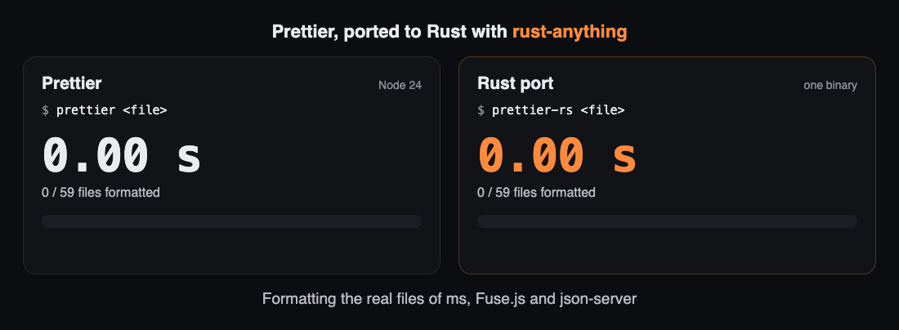

# everything-rust

**Port an app to Rust without losing its behaviour.** everything-rust records what your code does
today, then checks every piece of the Rust rewrite against that recording until the whole thing
runs in Rust.

It works on Node.js (TypeScript/JavaScript), Python, C, Go, Ruby, Java and Kotlin projects: CLIs,
HTTP servers and libraries. It never translates code. Your coding agent writes the Rust, and
everything-rust decides what to move, proves it matches, and gates the merge.

[](https://crates.io/crates/everything-rust)
[](LICENSE)


## The loop

1. **Record.** `record` runs the original on generated edge cases, semantic traps and your own
   inputs, and saves every return value and every throw.
2. **Port.** `bridge` scaffolds a Rust crate plus a wrapper that keeps the original API, so the
   rest of your code stays untouched while the port grows behind it.
3. **Check.** `diff` replays every recorded case against the Rust. `fuzz` adds fresh inputs.
   `gate` fails the port on anything that would not survive review or shipping.
4. **Lift.** Once replay passes with no fallback to the original and every unit passes `gate`,
   `app lift` makes it a pure Rust app. The original is never modified.

```sh
everything-rust profile . -- node bench.mjs              # where the time goes, and who calls it
everything-rust bridge . src/fuzzy.ts --batch fuzzyScore:text
# write src/port.rs, or let your agent write it, then:
everything-rust record rust/fuzzy-rs && everything-rust build rust/fuzzy-rs
everything-rust diff rust/fuzzy-rs                       # every recorded case must match
everything-rust fuzz rust/fuzzy-rs --time 60 --keep      # inputs the recording never saw
everything-rust bench rust/fuzzy-rs                      # faster, or not: the verdict says
everything-rust gate rust/fuzzy-rs                       # done means this passes
```

At the bridge, [napi-rs](https://github.com/napi-rs/napi-rs), [PyO3](https://github.com/PyO3/pyo3)
and [wasm-bindgen](https://github.com/wasm-bindgen/wasm-bindgen) carry the calls between your
language and Rust.

## What it has actually done

Same output as the original, measured on an Apple M4, two runs each, every output compared before
timing ([method and details](docs/real-world.md)):

| Project | Original | With everything-rust |
| --- | ---: | ---: |
| [Prettier](docs/real-world.md#prettier) 3.6.2, 2,360 JS/TS files from the CLI | 128.6 s | **6.9 s — 19x** |
| Prettier, 6,305 Markdown files from the CLI | 352 s | **22.5 s — 15.6x** |
| [json-server](docs/real-world.md#json-server), idle memory of the whole server | 74 MB | **3.5 MB**, one 5.3 MB binary |
| json-server, start to first response | 79–85 ms | **8–10 ms** |
| [Fuse.js](docs/real-world.md#fusejs), one query over 50,000 strings | 91.2 ms | **2.8 ms — 32x** |

Prettier formats 15,861 of 17,224 recorded runs fully in Rust, across JavaScript, TypeScript, JSX,
JSON, GraphQL, YAML, Markdown, CSS, SCSS and Less; all 17,224 match Prettier byte for byte, because
whatever is not ported yet falls back to Prettier. json-server matches 514 of 514 recorded HTTP
cases on a pure Rust binary.

A single call into Rust is usually slower than a JIT; the win is in the loop you move. Against C the
win is safety, not speed: [ffmpeg's libavutil](docs/real-world.md#ffmpeg) matches all 226,447
recorded calls at roughly C's speed (18 of 42 benchmarks even, 8 faster, 16 slower by 3 to 40%).

<p align="center">
  <br>
  <sub>Prettier against its Rust port on 59 files from ms, Fuse.js and json-server (Apple M4). <a href="docs/real-world.md#prettier">How it was measured</a>.</sub>
</p>

## Move only what is slow

Porting the whole app is optional. Point `go` at the command that is too slow:

```sh
everything-rust go --agent claude -- python3 app.py
```

It profiles the run, picks the outermost function worth moving (the loop, not the small call inside
it, batched where the profile says so), records it on generated inputs plus the calls your run
makes, and hands `src/port.rs` to your agent. With `claude`, `codex`, or any command that reads a
prompt on stdin it writes the Rust; without `--agent` it writes `TASK.md` and stops. The port is
switched on only when every recorded case matches and `gate` passes.

```sh
everything-rust report rust/dedupe-rs     # REPORT.md and card.svg for the pull request
everything-rust disable rust/dedupe-rs    # back to the original, byte for byte
```

The Fuse.js row above is this shape: Fuse's per-string score, batched across the list, moved to Rust
while object keys and extended search stayed in JavaScript. Try `go` on
[`tests/fixtures/go-fuzzy`](tests/fixtures/go-fuzzy), a 20-line Python dedupe. Switching a port on
and off in every way: [How it works](docs/how-it-works.md#switch-a-port-on-and-off).

## Install

```sh
cargo install everything-rust   # from crates.io
everything-rust setup           # registers it with Claude Code, Codex, Cursor, Gemini CLI, OpenCode
```

Or let an agent do it. Paste into Claude Code, Codex, Cursor, Gemini CLI or OpenCode:

```text
Install everything-rust: run `cargo install everything-rust`, then `everything-rust setup`.
Tell me when to restart you.
```

No Rust toolchain? Prebuilt macOS, Linux and Windows binaries sit on each
[release](https://github.com/AmmarArief/everything-rust/releases); for JavaScript projects,
`npm install -g everything-rust` installs the same binary.

Plugins, when the CLI is already on `PATH`:

```text
/plugin install everything-rust --marketplace AmmarArief/everything-rust
```

```sh
codex plugin marketplace add AmmarArief/everything-rust
codex plugin add everything-rust@everything-rust
```

`setup` adds the MCP server where each agent reads it and installs the workflow skill; it keeps your
other settings, is safe to re-run, and `--remove` undoes it. Before rewriting a file that exists it
saves `<file>.everything-rust.bak` beside it (`--no-backup` skips that).

| Agent | Added by `setup` |
| --- | --- |
| Claude Code | MCP server in `~/.claude.json`, skill in `~/.claude/skills/` |
| Codex | MCP server in `~/.codex/config.toml`, skill in `~/.codex/skills/` |
| Cursor | MCP server in `~/.cursor/mcp.json` |
| Gemini CLI | MCP server in `~/.gemini/settings.json` |
| OpenCode | MCP server in `~/.config/opencode/opencode.json` (`mcp.servers`), skill in `~/.config/opencode/skills/` |
| Any other MCP client | `everything-rust mcp` as a stdio server, by hand ([install](docs/install.md#install)) |

OpenCode by hand: put the server in `~/.config/opencode/opencode.json` (`command` is the whole
argv), and copy [`skills/everything-rust/`](./skills/everything-rust) into
`~/.config/opencode/skills/everything-rust/`:

```json
{
  "mcp": {
    "servers": {
      "everything-rust": { "type": "local", "command": ["everything-rust", "mcp"] }
    }
  }
}
```

Then ask, for example:

- *"Rewrite this CLI in Rust with everything-rust, end to end, and prove it behaves the same."*
- *"This search feels slow. Profile it with everything-rust and move the hot loop to Rust."*
- *"Plan a migration of `src/parser/` to Rust with everything-rust; port the first unit and prove it."*
- *"Bench the Rust port in `rust/text-rs` against the original and tell me whether to ship it."*

What the tool supplies that an agent cannot guess: where the time goes, what to port first and in
which order, a bridge that keeps the caller's API, the exact behaviour the port must match, a safe
way to ship it, and a gate that says when a port is done.

## The ports it ships

`eslint-rs` runs the Rust port for what it covers and ESLint 10.15.0, pinned as a dependency, for
everything else. The output is ESLint's either way.

```sh
npm install -g eslint-rs     # ESLint 10.15.0
```

| Command | Answered in Rust | Handed to ESLint 10.15.0 |
| --- | --- | --- |
| `eslint-rs` | `--no-config-lookup --rule ... --stdin` with 90 ported rules (`stylish` and `json` output, fixes, suggestions) | `eslint.config.*` lookups (`eslint .`), files and folders, the other 202 core rules, plugins, parsers, other formatters, parse errors |

Installed from its tarballs on macOS arm64, `eslint-rs` matches ESLint 10.15.0 installed beside it
on all 10,585 recorded runs ([how](docs/packaging.md#a-whole-cli-front-door)). Binaries exist for
macOS (arm64, x64) and Linux (x64, arm64, glibc); on Windows, or with `EVERYTHING_RUST_MODE=old`,
it runs ESLint itself: same output, no speedup.

`prettier-rs` (Prettier 3.6.2) is packaged the same way and replays 17,224 of 17,224 recorded runs
from its tarballs, 7.9% handed back to Prettier, but it is not on npm. `everything-rust package`
turns any CLI front door into a package like these.

## Languages

| Language | Unit | Bridge |
| --- | --- | --- |
| TypeScript/JavaScript | folder or file | napi-rs or wasm-bindgen with a generated binary wire; classes and async included |
| Python | package or module | PyO3 (abi3), direct conversion, typed exceptions |
| C | `.c` file | `extern "C"` functions with the original names and a header |
| Go | package | typed cgo calls and a generated binary wire, in a package with the original API |
| Ruby | file or folder of module functions | a magnus extension under the original modules |
| Java | package of `public static` methods | typed JNI and a generated binary wire, in wrapper classes with the original methods |
| Kotlin | Gradle module of top-level functions and `@JvmStatic` methods | typed JNI in Java wrapper classes calling the compiled Kotlin statics |
| PHP | file or folder of top-level functions (`public static` methods stay in PHP) | a JSON dispatcher over `ext-ffi`, in a file that redeclares the original signatures |
| C# | file or folder of `public static` methods | a JSON dispatcher over P/Invoke, in `<namespace>.Rust` classes with the original methods |

Each language also has a driver that records the original and replays it: Node on the `.ts` sources,
Python importing the original, a shared C library through ctypes with one fork per case, generated
Go, Ruby, Java, Kotlin, PHP and C# drivers, and `dotnet build` compiling the C# driver with the
project's sources. Every language except C, PHP and C# gets batch classes (`--batch`): items cross
once, stay in Rust, and each call runs over all of them on all cores.

The language is detected from the repository (`go.mod`, `pom.xml`, `build.gradle`/`build.gradle.kts`,
a `.csproj` or `.sln`, `pyproject.toml`, `Gemfile`, `composer.json`, `package.json`, else the most
common source files); a Gradle module with `.kt` sources and no `.java` sources is Kotlin, and mixed
modules stay Java. `--lang` overrides the guess. Types come from the source: TS types, Python hints,
C, Go, Java, Kotlin and C# signatures, Ruby YARD tags, PHP types and phpdoc; untyped parameters used
as numbers are inferred as numbers.

**Android.** `everything-rust build <crate> --profile android` builds the JNI library with the NDK
for `arm64-v8a`, `armeabi-v7a` and `x86_64` (or your `--abi` values) and installs it into
`<crate>/jniLibs/<abi>/`. `--api` sets the API level, minimum 26, which the generated Java runtime
needs. The NDK comes from `ANDROID_NDK_HOME`, `ANDROID_NDK_ROOT` or the SDK; the Rust targets must
be installed (`rustup target add aarch64-linux-android armv7-linux-androideabi
x86_64-linux-android`); 64-bit libraries link with 16 KB page alignment, and every JNI entry point
is checked as exported. Gradle looks in `src/main/jniLibs`, so pass `--jni-libs
app/src/main/jniLibs` or add `<crate>/jniLibs` to `sourceSets.main.jniLibs.srcDirs`. On a device,
`record <crate> --profile android` runs the original Kotlin under ART, dexes the driver with the
SDK's `d8`, and pulls back the same `cases.jsonl`; `diff <crate> --profile android` replays it
against the `.so` built for the device ABI. Both need `adb`, a device, `kotlinc`, an SDK with
build-tools and a platform, and `--device <serial>` when several devices are attached. Logic units
only: Activity/Compose/XML UI, lifecycle and SDK-only classes stay in Kotlin, and each call crosses
JNI, so hot loops want the batch wrappers. On a host, `record` and `diff` keep using the desktop JVM.

**PHP and C#.** `analyze` plans a PHP app (Composer packages, PSR-4 autoloading, risks such as loose
comparison and integer overflow into floats) or a C# project (`.csproj` and NuGet packages mapped to
crates, `using` directives resolved to folders, and `decimal`, `dynamic`, LINQ's deferred queries,
`Task`, `lock` and reflection flagged). CLIs and servers in both languages can be recorded, replayed
and put behind a Rust front door. Bridged calls cross as JSON, about 1 µs for PHP and 1–3 µs for
C#, so `bench` shows small functions slower than the originals; neither has `shadow` yet
([issue #200](https://github.com/AmmarArief/everything-rust/issues/200)).

## Before you record

`record` and `app record` run your original code, calling each function, or the whole app, on many
generated inputs; `app record` runs every case twice. `diff`, `gate` and `app replay` run the same
cases again against the port or the original. Code that writes files, talks to a database or calls
the network does that once per case. Run them on a copy of the project, against a test database, with
no production credentials in the environment.

Side effects are recorded too, so a rewrite that prints the right output but sends the email twice
fails. See [side effects](docs/whole-apps.md#side-effects-email-webhooks-and-databases).

## Docs

- [How it works](docs/how-it-works.md): the loop, what `bridge` and `analyze` decide, what the check cannot catch, what a real port takes, and keeping up with the original (`map`)
- [Port a whole app](docs/whole-apps.md): servers, CLIs and libraries, from the front door to `app lift`
- [Ship a port as a package](docs/packaging.md): maturin wheels and napi-rs per-platform npm packages, with the CI that builds them
- [Real-world ports](docs/real-world.md): json-server, Fuse.js, vercel/ms, with benchmarks
- [Examples](docs/examples.md): x18n, and real code in eight languages
- [Install and develop](docs/install.md) · [FAQ](docs/faq.md) · [Status](docs/STATUS.md) · [MCP tools](docs/tools.md)

## Contributing

Issues and pull requests are welcome. [CONTRIBUTING.md](./CONTRIBUTING.md) covers setup, where tests
go, and how to add a language; [DECISIONS.md](./DECISIONS.md) records why the design is what it is.
Case studies of real ports are especially wanted. Report security problems privately
([SECURITY.md](./SECURITY.md)), and read the [code of conduct](./CODE_OF_CONDUCT.md).

## License

[MIT](./LICENSE) © [M. Ammar R. Arief](https://github.com/AmmarArief). Ports and generated code in
your repository are yours.

everything-rust is an independent project, not affiliated with or endorsed by the Rust Project or
the Rust Foundation. "Rust" is a trademark of the Rust Foundation.
